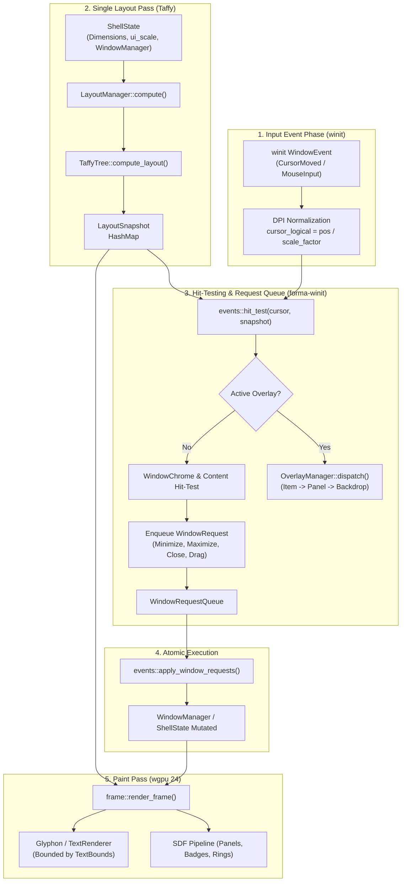

# MindSet OS UI Architecture v3 — Formal Architectural Specification

**Document Version:** 3.0.0  
**Status:** Approved for Implementation  
**Target Platform:** MindSet OS (100% Pure Rust + wgpu 24 Desktop OS)  
**Engineering Team:** LKS PVT LTD UI Systems & Product Architecture  

---

## 1. Executive Summary & Design Vocabulary

MindSet OS UI Architecture v3 establishes a unified, compile-time verified, zero-drift graphical subsystem by synthesizing proven patterns from battle-tested Rust UI projects:

- **P1 — Taffy (Single Computed Layout Pass):** The entire layout tree is computed once per frame from screen dimensions and logical UI scale. Both paint (`frame.rs`) and hit-test (`event_handler.rs`) consume the exact same `LayoutSnapshot`.
- **P2 — Azul (Subsystem Managers):** Responsibilities are partitioned into isolated managers (`LayoutManager`, `WindowChromeManager`, `OverlayManager`).
- **P3 — forma-winit (WindowRequest Queue):** Event handlers never directly mutate window state flags (`win.rect`, `win.state`, `win.is_open`). They enqueue typed `WindowRequest`s that are processed in an atomic pass.
- **P4 — DPI Coordinate Discipline:** All layout authored in logical coordinates. `ui_scale` is applied strictly in a single location (`LayoutManager`).
- **P5 — glyphon / cosmic-text (Text Clipping Primitive):** Text rendering requires two bounds: layout width via `Buffer::set_size` for reflow/wrapping, and hardware scissoring via `TextBounds` for clipping.
- **P6 — wgpu-gameui (Layout Invariant Assertions):** Layout validation (`assert_no_overlaps`, `assert_no_clipping`, `assert_contained`) is executable in headless CI tests.
- **P7 — jag (Clean Separation of Concerns):** Surface layer partitioned into `layout/`, `events/`, `render/`, and `text/`.

---

## 2. Module Map & Responsibilities (Pattern P7 Split)

```
crates/mindset-surface/src/
├── layout/                     # [P1/P2/P4/P6] Layout Tree, Geometry & Subsystem Managers
│   ├── mod.rs                  # Module facade & re-exports
│   ├── manager.rs              # LayoutManager (Taffy tree solver & cache)
│   ├── snapshot.rs             # LayoutSnapshot, UiId, and invariant assertions
│   ├── chrome.rs               # WindowChromeManager (deterministic 26x26 min hit-boxes)
│   └── overlay.rs              # OverlayManager (strict modal dispatch & backdrop rules)
├── events/                     # [P2/P3/P4] Input Dispatch & Request Queue
│   ├── mod.rs                  # Module facade
│   ├── hit_test.rs             # Deepest-node resolution against LayoutSnapshot
│   ├── request.rs              # WindowRequest queue definition
│   └── dispatch.rs             # Atomic apply_window_requests executor
├── wm.rs                       # Multi-Window Compositor & Z-Order State
├── session.rs                  # SessionManager, Dock & Notification drawer
├── desktop.rs                  # Wallpaper and icon positioning
└── lib.rs                      # Crate root re-exports

bins/mindset-os/src/
├── frame.rs                    # Paint layer: ONLY reads LayoutSnapshot, renders SDF & Text
├── event_handler.rs            # Input layer: ONLY runs hit_test() & enqueues WindowRequests
├── state.rs                    # ShellState & single-source show_desktop transition
└── main.rs                     # Event loop orchestration & regression test suite
```

---

## 3. Data Flow Diagram



---

## 4. Subsystem Manager Ownership Table (Pattern P2)

| Manager | Owned State | Authorized Mutator Functions | Invariants Enforced |
|:---|:---|:---|:---|
| **`LayoutManager`** | Taffy layout tree, `LayoutSnapshot`, `ui_scale` | `LayoutManager::compute(state, screen_w, screen_h, ui_scale)` | No layout rect is calculated outside this manager. Single source of truth. |
| **`WindowChromeManager`** | `WindowChromeHitTargets` | `WindowChromeManager::targets(rect, ui_scale)` | Close button is structurally distinct from Maximize. Minimum hit box is $26 \times 26$ logical px. |
| **`OverlayManager`** | Modal registration, active overlay stack | `OverlayManager::dispatch(overlay, cursor, snapshot)` | Strict 3-stage dispatch: (1) interior item hit-test, (2) panel containment trap, (3) backdrop dismiss. |
| **`DesktopTransitionManager`** | `state.show_desktop` | `ShellState::set_show_desktop(bool)`, `ShellState::toggle_desktop()` | Zero assignments to `show_desktop` outside these 2 functions. Automatically restores `WindowId::Today` when desktop is hidden. |

---

## 5. Coordinate-Space Contract (Pattern P4)

1. **Logical Pixels Everywhere:** All widget dimensions, margins, paddings, and font sizes are defined in logical pixels where $1.0 = 100\%$.
2. **Single Multiplier Point:** `ui_scale.clamp(0.80, 1.50)` is multiplied **only** during `LayoutManager::compute()`.
3. **Hit-Testing Invariant:** `event_handler.rs` and `events/` never multiply by `ui_scale` or `s`. Input coordinates are matched 1:1 against `LayoutSnapshot` rects.
4. **Verification Gate:**
   ```bash
   # Must return 0 hits:
   Select-String -Path bins/mindset-os/src/event_handler.rs -Pattern "(\*\s*ui_scale|\*\s*s\b)"
   ```

---

## 6. Hit-Test Dispatch Order (Pattern P2 & P3)

When a mouse click arrives, dispatch follows a strict hierarchical priority:

1. **Top Bar Critical Capsule Island:** If $y \le \text{TOP\_BAR\_H}$, test menus, flash pill, map pill, clock, notifications, and Control Center button.
2. **Active Overlay (if any):**
   - **Stage 1 (Items):** Test all interior controls (tiles, sliders, buttons, list rows). If matched, trigger action and return.
   - **Stage 2 (Panel Containment):** If click is within the panel bounds, trap the event and return (never bleed through to underlying windows).
   - **Stage 3 (Backdrop Dismissal):** If click is outside panel, dismiss overlay and return.
3. **Window Chrome:**
   - Test `chrome.close_btn` $\rightarrow$ enqueue `WindowRequest::Close`.
   - Test `chrome.max_btn` $\rightarrow$ enqueue `WindowRequest::ToggleMaximize`.
   - Test `chrome.min_btn` $\rightarrow$ enqueue `WindowRequest::Minimize`.
   - Test `chrome.titlebar_drag` $\rightarrow$ enqueue `WindowRequest::Drag`.
   - Test `chrome.resize_grip` $\rightarrow$ enqueue `WindowRequest::Resize`.
4. **Window Content:** Lookup content rect from `LayoutSnapshot` for active window.
5. **Desktop Widgets (Left Column & Search Pill):** Lookups from `LayoutSnapshot`.
6. **Today Root Screen:** [START FOCUS], progress rings, future self card.

---

## 7. Text Clipping Contract (Pattern P5)

Every text element rendered via `TextRenderer` / `cosmic-text` must adhere to:
1. **Layout Sizing:** `buffer.set_size(font_system, Some(rect.w), Some(rect.h))` enforces text flow and word wrapping.
2. **Hardware Scissoring:** `TextArea.bounds` must be constructed with:
   ```rust
   let bounds = TextBounds {
       left: container_rect.x.floor() as i32,
       top: container_rect.y.floor() as i32,
       right: (container_rect.x + container_rect.w).ceil() as i32,
       bottom: (container_rect.y + container_rect.h).ceil() as i32,
   };
   ```
3. **Scale Invariant:** `TextArea.scale = 1.0` strictly enforced; font size is pre-scaled by DPI.

---

## 8. Layout Invariant Assertions (Pattern P6)

`LayoutSnapshot` provides three automated validation methods used in unit and CI tests:

```rust
impl LayoutSnapshot {
    /// Asserts that no two widgets in the provided slice overlap in 2D space.
    pub fn assert_no_overlaps(&self, ids: &[UiId]) -> Result<(), Vec<LayoutViolation>>;

    /// Asserts that child is fully contained within parent with zero bleeding.
    pub fn assert_contained(&self, parent: UiId, child: UiId) -> bool;

    /// Asserts that no widget rect exceeds viewport boundaries.
    pub fn assert_no_clipping(&self, id: UiId) -> Result<(), LayoutViolation>;
}
```

These assertions run across viewports $\{768\times 1024, 1080\times 1920, 1440\times 2560\}$ and scales $\{0.80, 1.0, 1.25, 1.45\}$.
