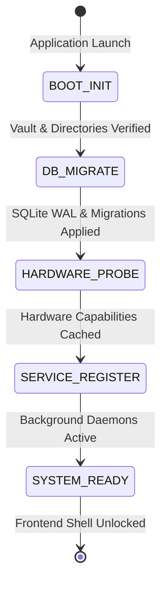

# MINDSET OS — SPECIFICATION 01: CORE ARCHITECTURE, RUST KERNEL, DATABASE & AUTH
**Organization:** LKS PVT LTD  
**System Designation:** MindSet OS (Self-Directed Intelligence & Focus Operating System)  
**Target Platforms:** Desktop (Fedora Linux / Windows 11 64-bit) & Mobile Companion (Android / iOS)  
**Operating Memory Ceiling:** Strictly < 120 MB RSS for OS Shell + Native Rust Kernel (reserving 8.0 GB–9.5 GB on a 12 GB hardware budget for local Ollama / `llama.cpp` inference engines).

---

## 1. Zero-Bloat Architectural Mandates
1. **Zero Python / Zero ChromaDB / Zero PyTorch in Core Shell:**  
   All OS kernel scheduling, hardware telemetry, SQLite transactions, HLC conflict-free sync, and window focus management MUST execute natively in compiled Rust (`src-tauri`) and TypeScript. Python/Torch/FastAPI runtimes are strictly forbidden in the desktop client to guarantee cold-boot times under 900 ms and RAM footprint under 120 MB.
2. **Single-Process Native Core:**  
   The MindSet Kernel, Service Registry, Typed Event Bus, and Micro-Scheduler execute as cooperative asynchronous Tokio tasks within the single Tauri 2 binary. Bounded asynchronous MPSC and broadcast channels prevent unbounded memory growth.
3. **Hermetic User Data Partitioning:**  
   All databases, encrypted vaults, cryptographic keypairs, and vector embeddings reside strictly under `~/.mindset_data/` (or `%APPDATA%/MindSetOS/user-data/` on Windows). System binary updates and re-installs never alter, overwrite, or mutate user learning data.
4. **Deterministic Append-Only Cross-Device Sync:**  
   Direct cross-device overwrites of raw SQLite binary files are prohibited. `local_core.sqlite` serves local operations and vector indices, whereas `sync_oplog.sqlite` records deterministic Hybrid Logical Clock (HLC) row operations for peer-to-peer cryptographic reconciliation via MindSet Connect.

---

## 2. Monorepo Topology
```text
mindset-ecosystem/
|-- package.json                     # Monorepo root workspace orchestration scripts
|-- pnpm-workspace.yaml              # Workspace package definitions (packages/*, services/*, apps/*)
|-- Cargo.toml                       # Unified Rust virtual workspace
|-- tsconfig.base.json               # Canonical TypeScript configuration & module aliases
|-- specs/
|   `-- 01_CORE_KERNEL_AND_DB.md     # Master Architecture Specification 01
|-- packages/
|   |-- ui-core/                     # Shared React 19 + Tailwind CSS v4 + Aurora Focus Design System
|   |-- db-schema/                   # Shared TypeScript DB interfaces, SQL migrations & DTOs
|   |-- connect-protocol/            # Rust crate: Ed25519 certificates, QR pairing & HLC sync protocol
|   |-- focus-policy-engine/         # Rust crate: Distraction rules, timetable parsing & enforcement policies
|   |-- balance-engine/              # Free-time window detector, energy/mood matrix & prompt templates
|   |-- identity-engine/             # PersonalContextBuilder, 3-tier memory & living student profile
|   `-- i18n-locales/                # Localization bundles (en, ta, hi, te, ml, kn, bn, mr + tanglish)
|-- services/
|   `-- mindset-focus-guard/         # System-level Focus Guard daemon (D-Bus, nftables/WFP, process monitoring)
|-- apps/
|   |-- mindset-desktop/             # Primary Desktop OS Shell (Tauri 2 + Rust + React 19 + Vite 8)
|   |   |-- src/                     # React 19 UI shell, Zustand 5 state stores, custom frameless titlebar
|   |   `-- src-tauri/               # Native Rust Kernel, SQLite WAL engine, Local Biometrics
|   `-- mindset-mobile/              # Mobile Companion & Remote Sensory Node (Tauri 2 Mobile)
`-- user-data/                       # Default local path mapping for ~/.mindset_data/
    |-- db/
    |   |-- local_core.sqlite        # Working application database + sqlite-vec tables
    |   `-- sync_oplog.sqlite        # Cryptographic peer-to-peer sync oplog
    |-- vault/
    |   |-- my-laptop/               # Encrypted study artifacts & local uploads
    |   |-- my-phone/                # Synchronized mobile camera captures & audio memos
    |   `-- textbooks/               # Ingested PDF / EPUB study materials
    `-- certs/                       # Local Ed25519 identity keypairs & peer authorization certificates
```

---

## 3. MindSet Kernel & Event Bus Specification (`src-tauri/src/kernel/`)

### 3.1 Five-Phase Deterministic Boot Lifecycle
The MindSet Rust Kernel transitions sequentially through 5 immutable phases upon launch:



1. **`BOOT_INIT`**:
   - Resolves `$HOME/.mindset_data` (Windows `%APPDATA%/MindSetOS/user-data`).
   - Recursively verifies and creates directories with restricted user-only permissions (`0700` on POSIX):
     - `~/.mindset_data/db`
     - `~/.mindset_data/vault/my-laptop`
     - `~/.mindset_data/vault/my-phone`
     - `~/.mindset_data/vault/textbooks`
     - `~/.mindset_data/certs`
   - Initializes or loads local Ed25519 identity keypair (`device_id` derived from SHA-256 fingerprint of public key).

2. **`DB_MIGRATE`**:
   - Acquires exclusive lock on `local_core.sqlite` and `sync_oplog.sqlite`.
   - Validates header integrity via `PRAGMA quick_check`.
   - Executes pending incremental schema migrations within explicit transactions.
   - Registers `sqlite-vec` dynamic extension vectors if compiled with vector support.

3. **`HARDWARE_PROBE`**:
   - Detects peripheral presence without blocking execution:
     - Webcam device availability (via DirectShow / V4L2).
     - Microphone availability (via WASAPI / ALSA / PulseAudio).
     - Fingerprint biometric reader (queries Linux `net.reactivated.Fprint` via D-Bus; Windows Hello Biometric WinBio API).
     - Bluetooth controller status.
     - Dedicated Wi-Fi adapter enumeration (including Realtek `rtl88xxau` monitor capabilities).
   - Writes immutable `HardwareCapabilities` struct into Kernel Shared State (`has_mic`, `has_webcam`, `has_fingerprint`, `has_bluetooth`, `has_wifi_monitor`).

4. **`SERVICE_REGISTER`**:
   - Spawns asynchronous worker actors implementing the `KernelService` trait:
     - `SchedulerService`: 15-second cron scheduler for timetable modes and reminders.
     - `MemoryWatchdogService`: Monopolizes OS RAM telemetry; fires warning if RSS exceeds 85%.
     - `AuthService`: Biometric token validation and auto-lock coordinator.
     - `StorageService`: Vault file ingestion and atomic write coordinator.
     - `OllamaHealthService`: Polls local Ollama endpoint (`127.0.0.1:11434/api/tags`) every 60s without raising blocking errors if offline.

5. **`SYSTEM_READY`**:
   - Emits `KernelEvent::SystemReady` to the broadcast event bus.
   - Tauri emits frontend event `"mindset://kernel-ready"` with boot diagnostics.
   - Frontend dismisses bootloader splash screen and presents the Aurora Focus UI.

### 3.2 Service Registry Architecture (`registry.rs`)
Every kernel service implements the asynchronous `KernelService` trait:
```rust
#[async_trait::async_trait]
pub trait KernelService: Send + Sync {
    fn name(&self) -> &'static str;
    async fn start(&mut self, bus: Arc<EventBus>) -> Result<(), KernelError>;
    async fn stop(&mut self) -> Result<(), KernelError>;
    async fn health_check(&self) -> ServiceHealth;
}

#[derive(Debug, Clone, Serialize, Deserialize)]
pub struct ServiceHealth {
    pub name: String,
    pub status: ServiceStatus,
    pub estimated_ram_kb: u64,
    pub last_heartbeat_utc: String,
}

#[derive(Debug, Clone, Serialize, Deserialize, PartialEq)]
pub enum ServiceStatus {
    Healthy,
    Degraded(String),
    Stopped,
    Critical(String),
}
```

### 3.3 Typed Event Bus (`event_bus.rs`)
Constructed with a `tokio::sync::broadcast::channel(256)` bounded ring buffer. Every event is typed, serializable to JSON, and bridged into the Tauri webview via `AppHandle::emit`:

```rust
#[derive(Debug, Clone, Serialize, Deserialize)]
#[serde(tag = "type", content = "payload")]
pub enum KernelEvent {
    SystemReady { uptime_ms: u64, hardware: HardwareCapabilities },
    FocusSessionStateChanged { session_id: String, state: String, elapsed_secs: u32 },
    TaskCompleted { task_id: String, xp_earned: u32 },
    MoodLogged { mood: String, energy_tier: String },
    FreeTimeWindowDetected { start_time: String, duration_minutes: u32 },
    RamThresholdWarning { process_rss_mb: u64, system_used_percent: f32 },
    HardwareStateChanged { capabilities: HardwareCapabilities },
    SecurityLockTriggered { reason: String },
    ProfileUpdated { user_id: String },
    SyncOplogAppended { op_id: String, row_id: String, table_name: String },
}
```

### 3.4 Low-RAM Kernel Scheduler (`scheduler.rs`)
Operates on a low-overhead `tokio::time::interval(Duration::from_secs(15))` loop:
- **Timetable Transitions:** Checks user schedule (e.g., 05:00 Early Deep Work, 22:00 Sleep Preparation) and broadcasts state changes.
- **Micro-Reflection Windows:** Injects subconscious visualization reminders at 06:00 and gratitude prompts at 22:00.
- **Emergency RAM Purge:** If `sysinfo` reports system RAM > 85%, commands webview memory minimization and triggers Tauri garbage collection.

---

## 4. SQLite Database Architecture

### 4.1 Low-RAM Optimization Pragmas
Both `local_core.sqlite` and `sync_oplog.sqlite` run with strict resource caps:
```sql
PRAGMA journal_mode = WAL;
PRAGMA synchronous = NORMAL;
PRAGMA temp_store = MEMORY;
PRAGMA mmap_size = 33554432;      -- 32 MB Memory-Mapped I/O limit
PRAGMA cache_size = -8000;         -- Fixed 8 MB page cache (negative value = KiB)
PRAGMA foreign_keys = ON;
PRAGMA busy_timeout = 5000;
```

### 4.2 Core Relational Tables (`local_core.sqlite`)
```sql
-- Schema version tracking
CREATE TABLE IF NOT EXISTS schema_migrations (
    version INTEGER PRIMARY KEY,
    applied_at TEXT NOT NULL
);

-- Living Student Profile
CREATE TABLE IF NOT EXISTS user_profile (
    user_id TEXT PRIMARY KEY,
    display_name TEXT NOT NULL,
    role TEXT NOT NULL DEFAULT 'student',
    interface_lang TEXT NOT NULL DEFAULT 'en',
    ai_lang TEXT NOT NULL DEFAULT 'ta',
    conversation_style TEXT NOT NULL DEFAULT 'tanglish',
    goals_json TEXT NOT NULL DEFAULT '[]',
    focus_areas_json TEXT NOT NULL DEFAULT '[]',
    routine_json TEXT NOT NULL DEFAULT '{}',
    preferences_json TEXT NOT NULL DEFAULT '{}',
    interests_json TEXT NOT NULL DEFAULT '[]',
    permissions_json TEXT NOT NULL DEFAULT '{}',
    updated_at TEXT NOT NULL
);

-- Cryptographic Auth Credentials
CREATE TABLE IF NOT EXISTS auth_credentials (
    user_id TEXT PRIMARY KEY,
    password_hash TEXT NOT NULL,
    pin_hash TEXT,
    face_embedding_blob BLOB,
    fingerprint_enrolled INTEGER NOT NULL DEFAULT 0,
    auto_lock_minutes INTEGER NOT NULL DEFAULT 5,
    failed_attempts INTEGER NOT NULL DEFAULT 0,
    locked_until TEXT,
    FOREIGN KEY(user_id) REFERENCES user_profile(user_id) ON DELETE CASCADE
);

-- Tasks, Objectives & Priority Goals
CREATE TABLE IF NOT EXISTS tasks_and_goals (
    id TEXT PRIMARY KEY,
    parent_goal_id TEXT,
    title TEXT NOT NULL,
    subject_tag TEXT,
    priority INTEGER NOT NULL DEFAULT 2, -- 1=Urgent/Crucial, 2=Medium, 3=Low
    status TEXT NOT NULL DEFAULT 'pending', -- pending, in_progress, completed, archived
    target_score_weight REAL DEFAULT 1.0,
    scheduled_start TEXT,
    scheduled_end TEXT,
    completed_at TEXT,
    xp_reward INTEGER NOT NULL DEFAULT 10,
    updated_at TEXT NOT NULL
);

-- Habit Tracking & Streaks
CREATE TABLE IF NOT EXISTS habits (
    id TEXT PRIMARY KEY,
    title TEXT NOT NULL,
    category TEXT NOT NULL DEFAULT 'wellness',
    frequency_json TEXT NOT NULL DEFAULT '{"type":"daily"}',
    current_streak INTEGER NOT NULL DEFAULT 0,
    best_streak INTEGER NOT NULL DEFAULT 0,
    last_completed_date TEXT,
    updated_at TEXT NOT NULL
);

-- Encrypted Reflective Journaling
CREATE TABLE IF NOT EXISTS journal_entries (
    id TEXT PRIMARY KEY,
    title TEXT,
    content_md TEXT NOT NULL,
    gratitude_items_json TEXT NOT NULL DEFAULT '[]',
    mood_tag TEXT,
    energy_level TEXT,
    is_encrypted INTEGER NOT NULL DEFAULT 0,
    created_at TEXT NOT NULL,
    updated_at TEXT NOT NULL
);

-- Real-time Mood & Energy Check-ins
CREATE TABLE IF NOT EXISTS mood_checkins (
    id TEXT PRIMARY KEY,
    mood TEXT NOT NULL,
    energy_tier TEXT NOT NULL, -- Low, Medium, High, Hyper
    context_note TEXT,
    active_activity TEXT,
    created_at TEXT NOT NULL
);

-- Deep Work & Focus Sessions
CREATE TABLE IF NOT EXISTS focus_sessions (
    id TEXT PRIMARY KEY,
    profile_mode TEXT NOT NULL, -- ExamPrep, Coding, Reading, DeepWork
    planned_minutes INTEGER NOT NULL,
    actual_minutes INTEGER NOT NULL DEFAULT 0,
    task_id TEXT,
    interruption_count INTEGER NOT NULL DEFAULT 0,
    completed INTEGER NOT NULL DEFAULT 0,
    started_at TEXT NOT NULL,
    ended_at TEXT,
    FOREIGN KEY(task_id) REFERENCES tasks_and_goals(id) ON DELETE SET NULL
);

-- Unified Chronological Timeline Events
CREATE TABLE IF NOT EXISTS timeline_events (
    id TEXT PRIMARY KEY,
    event_type TEXT NOT NULL,
    title TEXT NOT NULL,
    metadata_json TEXT NOT NULL DEFAULT '{}',
    created_at TEXT NOT NULL
);

-- Ingested RAG Knowledge Documents
CREATE TABLE IF NOT EXISTS rag_documents (
    id TEXT PRIMARY KEY,
    file_path TEXT NOT NULL,
    title TEXT NOT NULL,
    subject_tag TEXT,
    total_pages INTEGER NOT NULL DEFAULT 1,
    last_read_page INTEGER NOT NULL DEFAULT 1,
    indexed_at TEXT NOT NULL
);

-- Chunked Text Vectors
CREATE TABLE IF NOT EXISTS rag_chunks (
    id TEXT PRIMARY KEY,
    document_id TEXT NOT NULL,
    page_number INTEGER NOT NULL,
    chunk_index INTEGER NOT NULL,
    content TEXT NOT NULL,
    FOREIGN KEY(document_id) REFERENCES rag_documents(id) ON DELETE CASCADE
);

-- Virtual Vector Search Table (sqlite-vec)
-- Dimension: 384 (all-MiniLM-L6-v2 compatible)
-- Fallback table created if sqlite-vec is not dynamically loaded
CREATE TABLE IF NOT EXISTS vec_memory_fallback (
    id TEXT PRIMARY KEY,
    embedding_json TEXT NOT NULL,
    source_type TEXT NOT NULL,
    source_id TEXT NOT NULL,
    created_at TEXT NOT NULL
);
```

### 4.3 Deterministic Hybrid Logical Clock (HLC) Sync Tables (`sync_oplog.sqlite`)
```sql
CREATE TABLE IF NOT EXISTS oplog_entries (
    op_id TEXT PRIMARY KEY,
    hlc_timestamp TEXT NOT NULL,        -- Format: <epoch_ms>:<counter>:<device_id>
    device_id TEXT NOT NULL,
    table_name TEXT NOT NULL,
    row_id TEXT NOT NULL,
    operation TEXT CHECK(operation IN ('INSERT', 'UPDATE', 'DELETE')) NOT NULL,
    payload_json TEXT NOT NULL,
    synced_devices_json TEXT NOT NULL DEFAULT '[]'
);

CREATE INDEX IF NOT EXISTS idx_oplog_hlc ON oplog_entries(hlc_timestamp);
CREATE INDEX IF NOT EXISTS idx_oplog_table_row ON oplog_entries(table_name, row_id);

CREATE TABLE IF NOT EXISTS trusted_devices (
    device_id TEXT PRIMARY KEY,
    device_name TEXT NOT NULL,
    device_type TEXT CHECK(device_type IN ('desktop', 'mobile')) NOT NULL,
    public_key_ed25519 TEXT NOT NULL,
    permissions_json TEXT NOT NULL DEFAULT '{"can_sync": true, "can_push": true}',
    last_seen_at TEXT NOT NULL,
    is_revoked INTEGER NOT NULL DEFAULT 0
);
```

---

## 5. Security, Biometrics & Smart Lock Architecture (`/auth`)

### 5.1 Multi-Modal Authentication Layers
1. **Passcode & Password:**
   - Password hashed via Argon2id (memory: 64 MB, time cost: 3 iterations) or bcrypt (cost 12).
   - Validated purely inside Rust memory; generates an ephemeral cryptographically signed session token (`MindSetSessionToken`) valid for `auto_lock_minutes`.
2. **Local Face Recognition (Transient ONNX Runtime):**
   - Single video frame acquired from local webcam (or MindSet Connect wireless phone camera stream).
   - Normalized into 112x112 RGB tensor, evaluated through an ultra-compact Face Embedding ONNX model yielding a 128-dimensional L2-normalized vector.
   - Cosine similarity computed against `auth_credentials.face_embedding_blob`. Match accepted if cosine similarity $\ge 0.82$.
   - **Crucial RAM Rule:** The ONNX inference environment is instantiated, executed, and immediately deallocated from RAM within $< 300\text{ ms}$, ensuring 0 MB baseline idle memory retention.
3. **Hardware Fingerprint (`fprintd` / Windows Hello):**
   - On Linux, connects over D-Bus to `net.reactivated.Fprint`.
   - On Windows, uses native Windows Biometric Framework (WinBio).
   - Graceful fallback: If no biometric hardware is detected during `HARDWARE_PROBE`, the UI seamlessly hides biometric glyphs without failing.
4. **Smart Lock Screen (`Super + L`):**
   - Renders a liquid glass Aurora Focus (`#07090D`) overlay.
   - Tabular monospace numerals clock.
   - Shows today's Priority 1 task and active Focus session timer.
   - Conceals private journal content, notes, and sensitive personal stats until authorized.
5. **UAC Elevation Gate:**
   - Critical operations (disabling Focus Guard, modifying network packet filter rules, revoking trusted devices) require immediate biometric re-verification.

---

## 6. UI Design Tokens (Aurora Focus)
- **Background Deep:** `#07090D`
- **Surface Primary:** `#111827`
- **Surface Secondary:** `#182235`
- **Surface Elevated:** `#202B40`
- **Accent Primary (Focus / Electric Indigo):** `#8B9CFF`
- **Accent Secondary (Vitality / Teal):** `#65E6C4`
- **Accent Achievement (Gold / Milestone):** `#FFD078`
- **Text Dominant:** `#F9FAFB`
- **Text Muted:** `#9CA3AF`
- **Border Subtle:** `#1F2937`
- **Border Glow:** `rgba(139, 156, 255, 0.25)`
