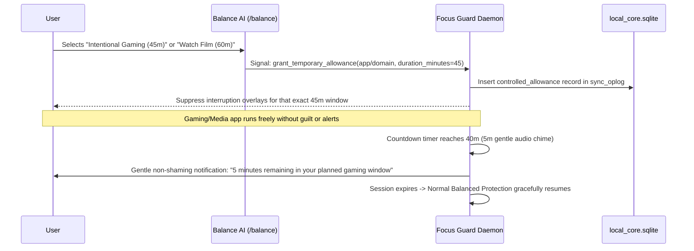

# MINDSET OS — SPECIFICATION 06: MINDSET BALANCE AI, FREE-TIME ENGINE & WELLBEING ANALYTICS

**Company:** LKS PVT LTD  
**Module:** MindSet Balance AI  
**Core Principle:** *"Productivity is not about filling every minute. It is about using time meaningfully while leaving room to live."*  
**RAM Budget:** < 8 MB RSS (Lightweight TypeScript rule engine + SQLite query evaluation)

---

## 1. Core Philosophy & Anti-Burnout Doctrine

Modern student software often promotes hyper-productivity, gamified guilt, and toxic streak tracking. MindSet OS adheres to a strict non-punitive, anti-burnout engineering doctrine:
1. **Never Convert Every Free Window into Study:** The AI must NEVER scan an empty slot on the timetable and default to "Study more Differential Equations". Free time is fundamentally legitimate and necessary for subconscious consolidation.
2. **Zero Toxic Productivity Scores:** MindSet OS will NEVER display a single "Productivity Score" (e.g. "You were 62% productive today"), percentile comparisons, or competitive peer leaderboards.
3. **Rest Without Guilt:** Complete rest, hobbies, family time, and sleep are first-class schedule citizens, not residual leftover moments.
4. **Subconscious Memory Consolidation:** Long-term potentiation in neural synapses requires diffuse-mode mental states, parasympathetic nervous system dominance, and uninterrupted REM/deep sleep.

---

## 2. Nine-Dimension Balanced Daily Scheduling (`packages/balance-engine`)

Every balanced day dynamically accounts for 9 core dimensions:
1. **Essential Responsibilities:** School, college lectures, mandatory coursework, or professional obligations (typically `08:00–17:00` baseline).
2. **Important Goals:** Focused academic deep work toward major milestones (e.g., scoring **590/600 in Tamil Nadu Class 12 State Board Exams** or mastering syllabus chapters).
3. **Learning & Personal Development:** Self-directed curiosity, reading non-syllabus books, exploring coding or science outside required curricula.
4. **Physical Activity & Outdoor Movement:** Walking, cycling, yoga, sports, or progressive stretching to oxygenate cerebral tissue and lower cortisol.
5. **Mental Relaxation & Mindfulness:** `4-7-8` breathwork, box breathing, gratitude reflection, or calm meditation.
6. **Intentional Entertainment:** High-quality, deliberate enjoyment (a planned film, budgeted video game session, music album, or comedy) distinguished from mindless compulsive scrolling.
7. **Social & Family Time:** Uninterrupted dinner conversation, family time (`19:30–20:30` protected block), or catching up with trusted friends.
8. **Unplanned Flexible Free Time:** A mandatory daily buffer (minimum 30–60 minutes) with zero planned activities, allowing spontaneity, decompression, or handling unexpected life events.
9. **Sleep & Recovery:** Protected nightly sleep window (`22:00–05:30` default; 7.5 to 8 hours), during which notifications are suppressed and UI automatically shifts to Forest Zen or deep dark night themes.

---

## 3. Four Energy Tiers & Nine Mood States

### 3.1 Four Energy Tiers
User energy levels fluctuate rhythmically through ultradian and circadian cycles:
- **`HIGH`:** High alertness, physical and mental stamina. Suitable for creative problem solving, brisk exercise, sports, and intense hobby projects.
- **`MEDIUM`:** Steady, calm presence. Suitable for leisurely walks, reading, photography, conversational catch-ups, or casual puzzle solving.
- **`LOW`:** Mental fatigue, cognitive saturation. Suitable for acoustic relaxation, ambient brown noise, restorative stretching, or intentional light entertainment.
- **`VERY_LOW`:** Cognitive exhaustion, sensory overload. Requires immediate screen-free rest, 15-minute power naps, 4-7-8 breathing, and reduction of non-essential commitments.

### 3.2 Nine Granular Mood States (`/mood`)
1. **`Happy`:** Uplifted, positive, receptive to social interaction or celebration.
2. **`Calm`:** Centered, peaceful, optimal for reflective journaling or mindfulness.
3. **`Excited`:** Energized, eager, great for launching creative projects or sports.
4. **`Bored`:** Under-stimulated, craving novelty; ideal for discovering beginner hobby challenges.
5. **`Tired`:** Physically weary; needs physical rest, hydration, and gentle movement.
6. **`Stressed`:** Sympathetic nervous system overdrive; requires cortisol-reducing breathwork (`4-7-8`), nature sounds, and reassurance.
7. **`Unmotivated`:** Dopamine-depleted; needs low-friction micro-actions, gentle walks, or screen-free decompression.
8. **`Curious`:** Intellectual appetite; ideal for science documentaries, astronomy, or tinkering.
9. **`Creative`:** Lateral thinking peak; perfect for sketching, writing, music, or crafting.

---

## 4. Seven Relaxation Categories

Activities recommended during free-time windows are balanced across 7 non-academic categories:
1. **Mental Relaxation:** Guided breathwork (`4-7-8` and Box breathing), gratitude journaling, progressive muscle relaxation, silent tea breaks.
2. **Physical Relaxation:** Gentle walking in fresh air, hamstring and spine stretches, slow cycling, foam rolling.
3. **Creative Activities:** Pencil sketching, playing an acoustic instrument, creative story writing, origami, watercolour painting.
4. **Intellectual Entertainment:** Astronomy and space exploration videos, chess puzzles, science documentaries, philosophy podcasts.
5. **Social & Family Activities:** Evening dinner conversations, board games with siblings, calling grandparents, helping prepare dinner.
6. **Intentional Entertainment:** Watching a curated movie, 45 minutes of gaming with an active budget, listening to a favourite music album with focused attention.
7. **Complete Rest:** Sitting outdoors, watching clouds/rain, laying down without any screen or audio input, feeling zero obligation to produce.

---

## 5. Free-Time Detection & Smart Micro-Break Planner

### 5.1 Gap Detection Algorithm (`FreeTimeDetector.ts`)
- Continuously scans scheduled tasks in `tasks_and_goals`, profile routine timings (`user_profile.routine`), and active calendar blocks.
- Identifies contiguous unscheduled gaps $\ge 15$ minutes.
- Evaluates proximity to the `22:00` sleep boundary: gaps overlapping `21:30–22:00` are strictly designated as **Night Wind-Down Windows**, forbidding high-energy stimulation.
- Always deducts a **15-minute unplanned buffer** from any detected gap before proposing structured recommendations, ensuring the user is never over-scheduled.

### 5.2 Smart Free-Time Planner (`SmartFreeTimePlanner.ts`)
For a detected 60-minute afternoon gap, generates a structured 4-phase micro-plan:
- **Phase 1 (00–10m):** Decompression & Hydration (step away from screens, drink water, physical stretch).
- **Phase 2 (10–30m):** Primary Recharging Activity (e.g. 20-minute neighborhood walk or sketching).
- **Phase 3 (30–45m):** Secondary Enjoyment (e.g. 15 minutes of favorite music or hobby practice).
- **Phase 4 (45–60m):** Transition & Mental Re-centering (2 minutes of deep breaths, reviewing next target calmly).
- The user can accept, customize, or completely discard the micro-plan with zero penalty.

---

## 6. Handshake Between Balance AI & MindSet Focus Guard

A critical architectural bridge links **Balance AI** and **Focus Guard**:

---

## 7. Personal Hobby Discovery Hub (12 Categories)

MindSet OS includes a rich repository of beginner-friendly hobby pathways:
1. **Art & Design:** Doodling, digital illustration, calligraphy, charcoal sketching.
2. **Technology:** Arduino/Raspberry Pi robotics, building text-based games in Rust/Python, home lab setup.
3. **Music:** Keyboard chords, acoustic guitar fingerpicking, Indian classical ragas, music theory.
4. **Sports & Fitness:** Calisthenics, badminton, running, table tennis, swimming.
5. **Reading:** Historical fiction, biography, popular science, poetry.
6. **Photography:** Mobile photography composition, macro nature photography, shadow and lighting.
7. **Gardening:** Balcony potted plants, herb gardens, bonsai care, indoor succulent propagation.
8. **Cooking & Baking:** Quick healthy snacks, making South Indian filter coffee, simple pasta dishes.
9. **Writing:** Micro-fiction, reflective poetry, nature journals, personal essays.
10. **Outdoor Exploration:** Bird watching, stargazing, identifying local trees, morning trail walking.
11. **Science & Puzzles:** Rubik's cube speedsolving, amateur astronomy, cryptography puzzles, Sudoku.
12. **DIY & Crafting:** Wood carving, leather crafting, origami, papercraft architecture.

Each hobby features **10-Minute Beginner Challenges** that eliminate intimidating learning curves.

---

## 8. Weekly Recharts Analytics (`/insights`)

- **Nine-Dimension Radar & Distribution:** Shows relative balance across Study, Learning, Physical, Relaxation, Entertainment, Social, Hobbies, Sleep, and Free Time.
- **Focus Time Trends:** Daily stacked or line charts of deep work minutes versus restorative breaks.
- **Supportive CoachAgent Written Observations:** Empathetic, qualitative feedback (e.g. *"You maintained consistent physical movement on 5 out of 7 days, which kept your afternoon fatigue low. Great balance between study and rest."*).
- **Anti-Toxic Metric Enforcement:** No arbitrary scores, no percentages of "efficiency", no red guilt indicators.
