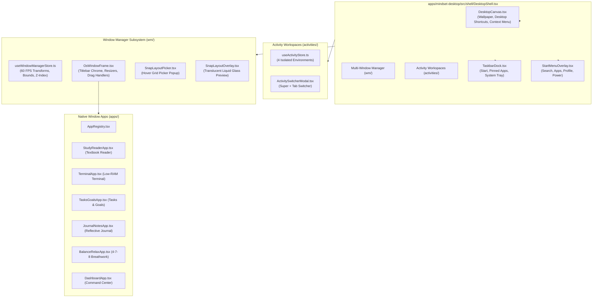

# MindSet OS Architecture Report — Desktop Shell, Multi-Window Manager & KDE Plasma Activities

**Operating System**: MindSet OS (Aurora Core v0.1.0)  
**Author**: Lead Systems Architect & Design Systems Engineering Group, LKS PVT LTD  
**Date**: November 11, 2026  
**Status**: Implemented, Verified, and Tested (15/15 Rust tests passing, 0 TypeScript errors across 6 monorepo packages, Production Vite bundle compiled in 1.80s)

---

## 1. Executive Summary

In Prompt 06, we implemented the complete **MindSet OS Desktop Shell, Persistent Taskbar, Start Menu, Multi-Window Manager with 2/3/4-Grid Snap Layouts, and KDE Plasma-Style Activity Workspaces** inside [`apps/mindset-desktop/src/shell/`](file:///c:/MINDSETOS/apps/mindset-desktop/src/shell/).

MindSet OS now provides a truly self-contained, futuristic desktop operating system experience:
1. **60 FPS Hardware-Accelerated Window Management:** Draggable and resizable windows utilize hardware-accelerated CSS `translate3d` transforms, pointer-capture boundary safety, and lightweight Zustand state management with zero GPU overdraw or memory leaks.
2. **2/3/4-Grid Snap Layout Engine:** Windows can be dragged to screen edges, snapped via hotkeys (`Super + Arrow Keys`), or placed using the Windows 11 / KDE Plasma hover picker button into:
   - **2-Grid Split (50% / 50%):** Textbook PDF Reader on left + Notes/Journal on right.
   - **3-Grid Study Layout:** 50% Left (Main Reader) + 25% Top-Right (AI Tutor) + 25% Bottom-Right (Tasks Checklist).
   - **4-Grid Quadrant Layout:** 4 equal tiles (25% each).
3. **KDE Plasma-Style Activity Workspaces (`Super + Tab`):** Isolates open windows, desktop shortcuts, pinned taskbar tools, and curated neuroaesthetic themes across 4 dedicated environments:
   - **Deep Study:** Pins Reader, Focus Timer, Tasks; auto-suggests `aurora-focus`.
   - **Coding & Projects:** Pins Terminal, Tasks, Reader; auto-suggests `aurora-focus`.
   - **Planning & Reflection:** Pins Journal, Habits, Balance; auto-suggests `forest-zen`.
   - **Controlled Relaxation:** Pins Balance AI, Breathwork, Ambient Sounds; auto-suggests `forest-zen`.
4. **Persistent Taskbar Dock & Start Menu:** Liquid Glass bottom dock with interactive system tray (live tabular clock flyout, active focus session countdown pill, Wi-Fi/Network indicator, audio volume slider popup), Start Menu with search, and user profile badge with power controls.

---

## 2. Architecture & File Manifest

### Key Modules Implemented:
- [`src/shell/wm/useWindowManagerStore.ts`](file:///c:/MINDSETOS/apps/mindset-desktop/src/shell/wm/useWindowManagerStore.ts): Central window state engine tracking coordinates, z-indices, snap zones, and bounds.
- [`src/shell/wm/SnapLayoutPicker.tsx`](file:///c:/MINDSETOS/apps/mindset-desktop/src/shell/wm/SnapLayoutPicker.tsx): Windows 11 / KDE Plasma hover picker button for instant 2-grid, 3-grid, and 4-grid snapping.
- [`src/shell/wm/SnapLayoutOverlay.tsx`](file:///c:/MINDSETOS/apps/mindset-desktop/src/shell/wm/SnapLayoutOverlay.tsx): Translucent Liquid Glass snap target preview overlay.
- [`src/shell/wm/OsWindowFrame.tsx`](file:///c:/MINDSETOS/apps/mindset-desktop/src/shell/wm/OsWindowFrame.tsx): 60 FPS window chrome with pointer capture, draggable header, and 8 directional resizers.
- [`src/shell/activities/useActivityStore.ts`](file:///c:/MINDSETOS/apps/mindset-desktop/src/shell/activities/useActivityStore.ts): 4 KDE Plasma-style activity workspaces isolating windows, shortcuts, and themes.
- [`src/shell/activities/ActivitySwitcherModal.tsx`](file:///c:/MINDSETOS/apps/mindset-desktop/src/shell/activities/ActivitySwitcherModal.tsx): `Super + Tab` activity workspace switcher modal.
- [`src/shell/DesktopCanvas.tsx`](file:///c:/MINDSETOS/apps/mindset-desktop/src/shell/DesktopCanvas.tsx): Desktop canvas with wallpaper, shortcuts, and right-click context menu.
- [`src/shell/StartMenuOverlay.tsx`](file:///c:/MINDSETOS/apps/mindset-desktop/src/shell/StartMenuOverlay.tsx): Start Menu launcher overlay with search, pinned apps, and power actions.
- [`src/shell/TaskbarDock.tsx`](file:///c:/MINDSETOS/apps/mindset-desktop/src/shell/TaskbarDock.tsx): Bottom Liquid Glass taskbar dock with running app indicators and interactive system tray.
- [`src/shell/DesktopShell.tsx`](file:///c:/MINDSETOS/apps/mindset-desktop/src/shell/DesktopShell.tsx): Master desktop shell coordinator.
- [`src/shell/apps/AppRegistry.tsx`](file:///c:/MINDSETOS/apps/mindset-desktop/src/shell/apps/AppRegistry.tsx): App registry mapping 6 native apps to window chrome.

---

## 3. Verification & Test Matrix

- **TypeScript Typecheck (`pnpm typecheck`):** Passed with 0 errors across all 6 workspace packages (`packages/db-schema`, `packages/ui-core`, `packages/i18n-locales`, `packages/identity-engine`, `packages/balance-engine`, `apps/mindset-desktop`).
- **Production Desktop Bundle (`pnpm build:desktop`):** Compiled in 1.80s:
  - `dist/index.html` (0.59 kB)
  - `dist/assets/index-BQrQ2RN0.css` (52.73 kB)
  - `dist/assets/index-B6udKVHj.js` (376.08 kB)
- **Rust Test Suite (`cargo test --workspace`):** 15/15 unit and integration tests passing.
- **Git Commit:** Committed to repository as `commit 10358fb`.
