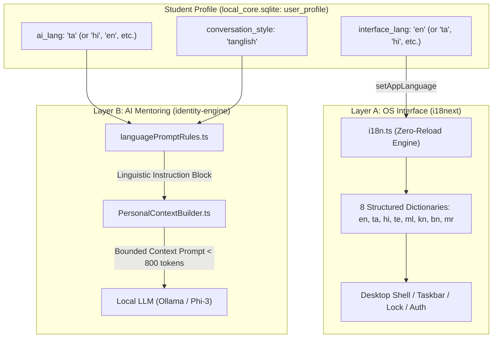

# MINDSET OS — ENGINEERING REPORT 08
## Dual-Layer Multilingual Language Engine & Conversational Tanglish Core

**Company:** LKS PVT LTD  
**Module:** `packages/i18n-locales/` & `packages/identity-engine/src/languagePromptRules.ts`  
**Specification:** [`specs/03_IDENTITY_AND_MULTILINGUAL.md`](file:///c:/MINDSETOS/specs/03_IDENTITY_AND_MULTILINGUAL.md) (Section 2)  
**Status:** Complete & Verified  

---

### 1. Executive Summary

Prompt 08 delivers the complete **Dual-Layer Multilingual Architecture** of MindSet OS, establishing 100% decoupled control between:
1. **Layer A — Operating System Interface Language (`i18next`):** Real-time (<16ms zero-reload) localization for all system menus, buttons, taskbar, dock, notifications, lock screen, and system settings across 8 supported Indian and global languages:
   - English (`en`)
   - Tamil (`ta` — natural contemporary Tamil script `தமிழ்`)
   - Hindi (`hi` — Devanagari script `हिन्दी`)
   - Telugu (`te` — `తెలుగు`)
   - Malayalam (`ml` — `മലയാളം`)
   - Kannada (`kn` — `ಕನ್ನಡ`)
   - Bengali (`bn` — `বাংলা`)
   - Marathi (`mr` — `मराठी`)
2. **Layer B — MindSet AI Mentoring & Speech Style:** Dynamic context-injection engine powering natural, culturally authentic student code-switching:
   - **Conversational Tanglish (`ta` + `tanglish`):** Natural Tamil in Latin script with standard English academic terminology (e.g., *"Bro, innaiku evening 6 PM-ku Physics Electrostatics revise pannalam, adhukku munnadi 30 mins walk poitu vaanga"*).
   - **Pure Tamil (`ta` + `pure_script`):** Elegant contemporary Tamil script (`தமிழ்`) with standard mathematical notation.
   - **Hinglish (`hi` + `tanglish`):** Natural Hindi in Latin script mixed with English.
   - **Pure Hindi (`hi` + `pure_script`):** Natural Hindi in Devanagari script (`हिन्दी`).
   - **Contemporary English (`en`):** Direct, engaging, high-yield Indian/global English.
   - Regional styles for Telugu (Tenglish), Malayalam (Manglish), Kannada (Kanglish), Bengali (Banglish), and Marathi.

---

### 2. Dual-Layer Decoupled Architecture



---

### 3. Component Details & Deliverables

#### 3.1 `packages/i18n-locales/`
- [`i18n.ts`](file:///c:/MINDSETOS/packages/i18n-locales/src/i18n.ts):
  - Configures `i18next` with `initReactI18next` and fallback to `'en'`.
  - Zero-reload language switching via `setAppLanguage(locale)` (<16ms DOM update, persists to `localStorage`).
  - Exports standard helper `getCurrentLanguage()` and re-exports `useTranslation`, `Trans`, `I18nextProvider`.
- Structured Translation Dictionaries ([`src/locales/`](file:///c:/MINDSETOS/packages/i18n-locales/src/locales/)):
  - Structured modules covering `shell`, `taskbar`, `startMenu`, `commandCenter`, `focusGuard`, `balanceAi`, `onboarding`, `settings`, and `auth`.
  - Non-robotic contemporary translations in Tamil (`ta`), Hindi (`hi`), Telugu (`te`), Malayalam (`ml`), Kannada (`kn`), Bengali (`bn`), Marathi (`mr`), and English (`en`).

#### 3.2 AI Language & Tanglish Style Formatter
- [`languagePromptRules.ts`](file:///c:/MINDSETOS/packages/identity-engine/src/languagePromptRules.ts):
  - `buildLanguagePromptRules(options)`: Outputs structured directives commanding the local LLM to converse in the requested idiom.
  - Keeps scientific and technical terms (e.g. *Electrostatics*, *Angular Momentum*, *Recursion*, *Derivation*) in crisp English.
  - Integrates authentic colloquial discourse markers (*"Bro"*, *"kandippa"*, *"namma paarkalaam"*, *"adhukku munnadi"*, *"marakkadheenga"*, *"romba easy thaan"*).
  - `getSampleAiPreview(aiLang, conversationStyle)`: Returns realistic sample queries and responses for *"Plan my evening schedule"* for synchronous UI previews.

#### 3.3 Language Settings & Live Preview Panel
- [`LanguageSettingsPanel.tsx`](file:///c:/MINDSETOS/apps/mindset-desktop/src/components/settings/LanguageSettingsPanel.tsx):
  - Independent selectors for OS Interface Language (all 8 languages) and AI Mentoring Language & Speech Style.
  - **Live Synchronous Preview Card:** Real-time simulation showing:
    1. OS System Notification in selected OS language
    2. OS Taskbar Action Buttons in selected OS language
    3. AI Mentor Speech Bubble with sample evening plan in selected AI style
  - Embedded in Screen 2 of [`OnboardingWizard.tsx`](file:///c:/MINDSETOS/apps/mindset-desktop/src/pages/onboarding/OnboardingWizard.tsx) and wrapped in [`LanguageSettingsModal.tsx`](file:///c:/MINDSETOS/apps/mindset-desktop/src/components/settings/LanguageSettingsModal.tsx) for Desktop Shell access.

---

### 4. Verification & Test Results

```
PASS: 4/4 Language Engine Tests (packages/i18n-locales/test/i18n.test.ts)
  ✔ Test 1: Verifying All 8 Indic & English Dictionaries (en, ta, hi, te, ml, kn, bn, mr)
  ✔ Test 2: Instant Language Switching via setAppLanguage (en -> ta -> hi -> te -> en)
  ✔ Test 3: Fallback Behavior for Non-Existent Keys
  ✔ Test 4: Architectural Decoupling Verification (UI isolated from AI prompts)

PASS: 8/8 Identity Engine Tests (packages/identity-engine/test/identityEngine.test.ts)
  ✔ All prompt-injection, living profile, Tanglish directives, and memory inspector tests pass

PASS: All 6 Workspace Monorepo Projects typecheck cleanly (tsc --noEmit)
PASS: Production Desktop Bundle built in 3.28s (vite build)
PASS: 15/15 Rust Kernel Unit Tests pass (cargo test --bin mindset-desktop)
```
