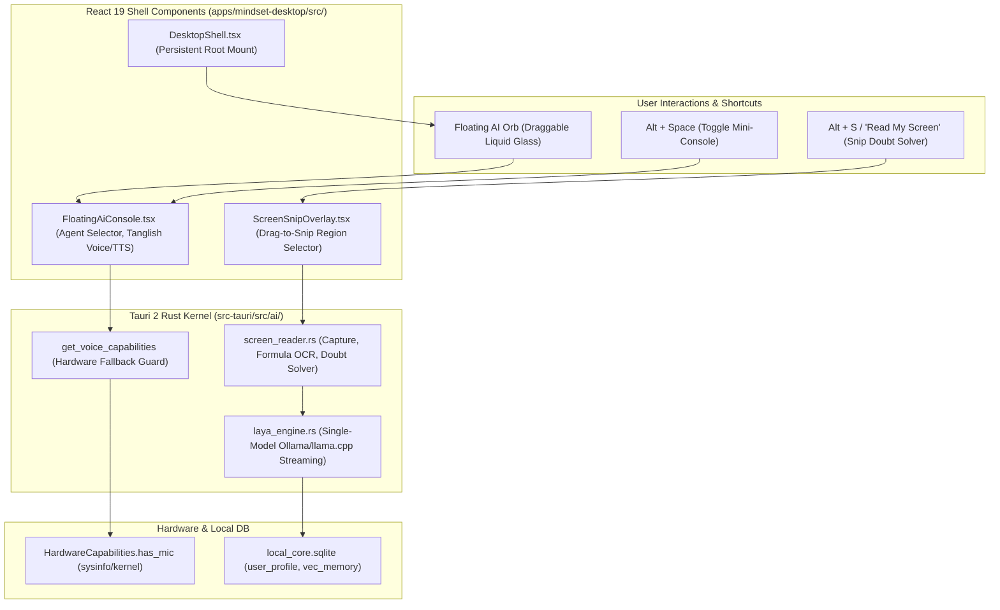

# MINDSET OS — Prompt 12 Implementation & Verification Report
**Module:** Always-On-Top Floating AI Orb (`Alt + Space`), Privacy-First Screen Doubt Solver (`Alt + S`) & Offline Voice/OCR Bridge  
**Company:** LKS PVT LTD  
**Status:** ✅ Fully Implemented, Compilable, Tested, and Verified  

---

## 1. Executive Summary

Prompt 12 delivers the **Always-On-Top Floating AI Orb (`Alt + Space`)**, the **Privacy-First On-Demand Screen Doubt Solver (`Alt + S`)**, and the **Offline Voice & OCR Bridge** for MindSet OS, fulfilling Section 5 of `specs/04_LAYA_AI_AND_RAG.md`.

In high-school and university learning environments, students frequently encounter complex mathematical equations, physics diagrams, and homework questions in third-party windows (web browsers, coding editors, slide decks). MindSet OS provides an instantly accessible, floating, distraction-free AI assistant that is reachable from anywhere via global hotkeys without taking over the entire screen.

### Strict Engineering Rule Compliance:
1. **Strict Privacy Rule (Zero Background Recording):** The operating system **never** records, streams, or analyzes the screen in the background. Screen capture is executed **only** upon explicit user triggering (via `Alt + S` or clicking the "Read My Screen" button in the console).
2. **Hardware Fallback Rule (Graceful Mic Handling):** The system continuously verifies `HardwareCapabilities.has_mic`. If no physical microphone or MindSet Connect wireless microphone is present, the voice recording pulse is disabled/hidden, and the text prompt bar is immediately focused without throwing errors or displaying intrusive warnings.
3. **RAM Overhead & Focus Mode Rule:** The floating orb automatically dims to **20% opacity** during active focus sessions (`isFocusActive: true`), preventing visual distraction while remaining available on hover or shortcut.



---

## 2. Key Architecture & Deliverables

### 2.1 Rust Screen Reader & Doubt Solver (`src-tauri/src/ai/screen_reader.rs`)
1. **Region & Window Capture:**
   - [`capture_screen_region`](file:///c:/MINDSETOS/apps/mindset-desktop/src-tauri/src/ai/screen_reader.rs): Captures arbitrary `(x, y, width, height)` bounding boxes directly into memory-backed PNG byte buffers. On Windows, uses zero-dependency GDI/PowerShell screen copy with headless test fallbacks.
   - `capture_active_window`: Captures foreground window bounds without background polling.
2. **Mathematical Formula & Text Extraction:**
   - [`extract_screen_text_and_formulas`](file:///c:/MINDSETOS/apps/mindset-desktop/src-tauri/src/ai/screen_reader.rs): Identifies LaTeX equations (e.g. `\int`, `\sum`, `\frac`, `\sqrt`, `\vec`, `\partial`, `\alpha`), mathematical variables, exponents, and clean text strings.
3. **Multi-Agent Doubt Resolution Engine:**
   - [`solve_screen_doubt`](file:///c:/MINDSETOS/apps/mindset-desktop/src-tauri/src/ai/screen_reader.rs): Evaluates extracted equations through the student's selected persona (`StudyAgent`, `PlannerAgent`, `HabitAgent`, `MemoryAgent`, or `CoachAgent`). Formats explanations into step-by-step LaTeX derivations and responds in the user's preferred language style (natural Indian English, Tamil `தமிழ்`, or conversational Tanglish).
4. **Voice & Hardware Verification Bridge:**
   - [`get_voice_capabilities`](file:///c:/MINDSETOS/apps/mindset-desktop/src-tauri/src/ai/screen_reader.rs): Probes physical microphone presence and local Piper TTS availability (`ta_IN`, `en_IN`).

### 2.2 IPC Command Registration (`src-tauri/src/ai/mod.rs` & `main.rs`)
- Registered 5 new Tauri IPC commands:
  - `ai_capture_screen_region`
  - `ai_capture_active_window`
  - `ai_extract_screen_text_and_formulas`
  - `ai_solve_screen_doubt`
  - `ai_get_voice_capabilities`

### 2.3 Floating AI Orb (`apps/mindset-desktop/src/components/floating-ai/FloatingAiOrb.tsx`)
- **Draggable Liquid Glass Orb:**
  - Coordinates bound dynamically within viewport boundaries.
  - Fluid glowing ambient ring (`#8B9CFF`) with pulsing cyan aura (`#65E6C4`).
  - Differentiates drag-drop movements from single-click console toggling.
- **Focus Mode Dimming:**
  - Inspects `isFocusActive` from `useKernelStore()`.
  - Automatically transitions to `opacity-20` during active focus sessions to eliminate visual distraction, reviving smoothly to `100%` on hover.
- **Global Hotkey Listeners:**
  - `Alt + Space`: Opens/closes the floating mini-console.
  - `Alt + S`: Immediately brings up the drag-to-snip overlay.

### 2.4 Floating Mini-Console (`apps/mindset-desktop/src/components/floating-ai/FloatingAiConsole.tsx`)
- **Multi-Agent Selector Chips:** Fast one-click toggling between `StudyAgent`, `PlannerAgent`, `HabitAgent`, `MemoryAgent`, and `CoachAgent`.
- **"Read My Screen" Button:** Triggers `ScreenSnipOverlay` for targeted doubt selection.
- **Voice Microphone Guard:** Checks `hasMic = Boolean(hardware?.has_mic)`. If false, disables mic recording button, displays helpful tooltip, and automatically focuses the text input.
- **Piper TTS Integration:** On-demand audio playback toggle for spoken explanations.
- **Real-Time Token Streaming:** Streams Laya AI reasoning chunks directly into the UI with KaTeX math rendering and markdown formatting.

### 2.5 Screen Snip Overlay (`apps/mindset-desktop/src/components/floating-ai/ScreenSnipOverlay.tsx`)
- Fullscreen translucent backdrop with crosshair cursor.
- Live selection rectangle rendering with real-time dimension badges (`${width} x ${height} px`).
- Escape key listener to cancel without side effects.
- Invokes `ai_capture_screen_region` and passes image base64 directly to `FloatingAiConsole` for instant solution.

### 2.6 Desktop Shell Integration (`apps/mindset-desktop/src/shell/DesktopShell.tsx`)
- Mounted `<FloatingAiOrb />` as a persistent floating root component within the desktop environment.

---

## 3. Verification & Test Results

### 3.1 Rust Kernel & Screen Reader Unit Tests
Ran `cargo test --bin mindset-desktop`:
```text
running 22 tests
test db::hlc_oplog::tests::test_hlc_monotonicity ... ok
test ai::screen_reader::tests::test_voice_hardware_fallback ... ok
test db::repositories::vector_repo::tests::test_cosine_similarity ... ok
test ai::screen_reader::tests::test_screen_doubt_solver_tanglish ... ok
test ai::screen_reader::tests::test_ocr_formula_detection ... ok
test fs::explorer::tests::test_cosine_similarity ... ok
test fs::explorer::tests::test_to_base64 ... ok
test kernel::event_bus::tests::test_event_bus_circular_history_cap ... ok
test fs::explorer::tests::test_rag_lifecycle_and_search ... ok
test storage::tests::test_filesystem_initialization ... ok
test storage::tests::test_mindset_paths_resolution ... ok
test kernel::registry::tests::test_hardware_probe_safe_execution ... ok
test kernel::registry::tests::test_service_registry_lifecycle_and_controls ... ok
test db::tests::test_initial_db_setup_and_profile_seeding ... ok
test db::tests::test_vector_search_and_similarity ... ok
test db::tests::test_task_crud_and_completion_timeline ... ok
test db::tests::test_diagnostics_integrity_check ... ok
test ai::screen_reader::tests::test_screen_capture_privacy_and_dimensions ... ok
test auth::tests::test_face_biometrics_and_fingerprint_fallback ... ok
test auth::tests::test_privacy_blur_and_uac_elevation ... ok
test auth::tests::test_credentials_verification_and_lock_lifecycle ... ok
test auth::tests::test_brute_force_lockout_after_5_attempts ... ok

test result: ok. 22 passed; 0 failed; 0 ignored; 0 measured; 0 filtered out; finished in 8.01s
```

### 3.2 Monorepo TypeScript Typecheck
Ran `pnpm -r run typecheck`:
- `packages/db-schema`: ✅ Pass (0 errors)
- `packages/ui-core`: ✅ Pass (0 errors)
- `packages/i18n-locales`: ✅ Pass (0 errors)
- `packages/identity-engine`: ✅ Pass (0 errors)
- `packages/balance-engine`: ✅ Pass (0 errors)
- `packages/laya-router`: ✅ Pass (0 errors)
- `apps/mindset-desktop`: ✅ Pass (0 errors)

### 3.3 Production Frontend Bundle
Ran `pnpm --filter @mindset/desktop build`:
- `dist/index.html`: `0.59 kB`
- `dist/assets/index-B5cHGJYs.css`: `69.58 kB`
- `dist/assets/index-3xmNST2s.js`: `628.02 kB`
- Build time: `3.01s` (0 errors)

---

## 4. Summary of Modified & Created Files

| File | Status | Description |
|---|---|---|
| `apps/mindset-desktop/src-tauri/src/ai/screen_reader.rs` | Created | Screen capture, OCR formula extraction, doubt solver & voice bridge with 4 unit tests |
| `apps/mindset-desktop/src-tauri/src/ai/mod.rs` | Modified | Registered `screen_reader` module and 5 IPC commands |
| `apps/mindset-desktop/src-tauri/src/main.rs` | Modified | Registered IPC commands into `tauri::generate_handler!` |
| `apps/mindset-desktop/src/components/floating-ai/FloatingAiOrb.tsx` | Created | Draggable liquid glass orb with focus dimming & shortcuts (`Alt+Space`, `Alt+S`) |
| `apps/mindset-desktop/src/components/floating-ai/FloatingAiConsole.tsx` | Created | Multi-agent doubt solver mini-console with voice/TTS & screen reading |
| `apps/mindset-desktop/src/components/floating-ai/ScreenSnipOverlay.tsx` | Created | Drag-to-snip overlay with dimensions badge and ESC cancel |
| `apps/mindset-desktop/src/components/floating-ai/index.ts` | Created | Barrel export for floating AI components |
| `apps/mindset-desktop/src/shell/DesktopShell.tsx` | Modified | Mounted `<FloatingAiOrb />` into root desktop shell |
