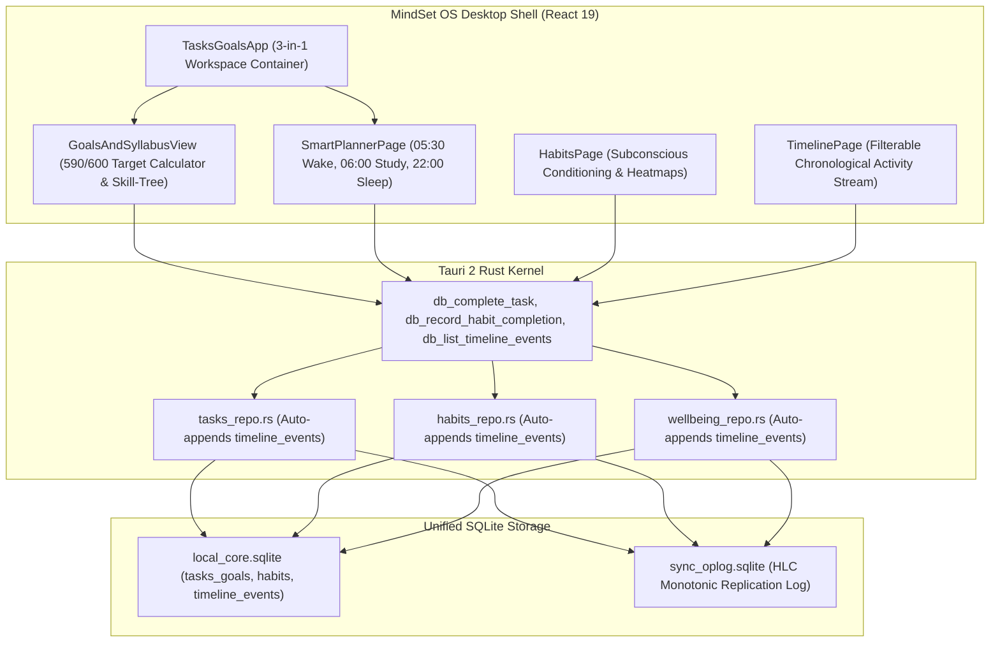

# MINDSET OS — Prompt 14 Implementation & Verification Report
**Module:** Academic Goal & Syllabus Breakdown Engine (`/goals` & `/tasks`), Smart Timetable Scheduler, Non-Punitive Habit Tracker (`/habits`) & Activity Timeline (`/timeline`)  
**Company:** LKS PVT LTD  
**Status:** ✅ Fully Implemented, Compilable, Tested, and Verified  

---

## 1. Executive Summary

Prompt 14 implements the **Academic Goal & Syllabus Breakdown Engine (`/goals` & `/tasks`)**, the **Smart Daily/Weekly Timetable Scheduler (`SmartPlannerPage`)**, the **Non-Punitive Habit Tracker (`/habits`)**, and the **Chronological Activity Timeline (`/timeline`)** for MindSet OS.

Traditional educational software burdens students with rigid due dates and red shaming banners whenever a streak is broken. MindSet OS adheres to the **Ethical Dopamine Rule**: every task, habit check-in, and chapter node progression triggers smooth progress bar fills, optional XP rewards (+10 to +75 XP), and chronological timeline logging—without punishing broken streaks. The Goal Engine breaks down ambitious academic targets (such as scoring **590/600 in Class 12 State Board Exams**) into subject weightages, chapter skill-trees, and one-click auto-scheduled revision queues.

### Strict Engineering Rule Compliance:
1. **590/600 Target Breakdown Rule:** Pre-loaded target calculator covering Tamil (98), English (96), Mathematics (100), Physics (98), Chemistry (99), and Computer Science (99) totaling 590/600 marks with engineering cut-off tracking (198.5/200), chapter-level mastery stages (`Not Started`, `Learning`, `Revision 1`, `Mastered`), and one-click **"Auto-Schedule Weak Chapters"** that slots unmastered chapters directly into SQLite `tasks_goals`.
2. **Ethical Dopamine & Non-Punitive Momentum:** Missed days present supportive, compassionate recovery prompts (*"Life happens! Every session is a fresh start. You're building lifelong discipline."*), accompanied by 14-day visual consistency heatmaps.
3. **Immutable Chronological Activity Logging:** Every completed task, focus session, habit check-in, and mood log automatically records an entry in `timeline_events` and an HLC revision in `sync_oplog.sqlite`.

---

## 2. Key Architecture & Deliverables

### 2.1 Academic Goal & Syllabus Skill-Tree Engine (`GoalsAndSyllabusView.tsx`)
Located in [`apps/mindset-desktop/src/pages/tasks/GoalsAndSyllabusView.tsx`](file:///c:/MINDSETOS/apps/mindset-desktop/src/pages/tasks/GoalsAndSyllabusView.tsx):
- **Subject-Wise Target Calculator:**
  - 6 Subjects configured: Tamil, English, Mathematics, Physics, Chemistry, Computer Science.
  - Live target total calculation (`590 / 600`) and engineering cut-off calculator (`198.5 / 200`).
  - Chapter nodes tracking weightage marks and status badges (`Not Started`, `Learning`, `Revision 1`, `Mastered`).
- **Interactive Chapter Skill-Tree & Learning Journey Map:**
  - Visual node grid displaying weightages, status, and milestone progression.
  - Advancing node status awards +35 XP and fills the syllabus progress ring.
  - One-click theme switcher to *Cosmic Arcade* (`#100D25`) for a gamified milestone visualizer.
- **One-Click Auto-Schedule Weak Chapters:**
  - Scans all unmastered or revision chapters and automatically creates Priority 1 tasks in SQLite `tasks_goals` for `PlannerAgent` to slot into upcoming study windows.

---

### 2.2 Smart Timetable & Time-Blocking Scheduler (`SmartPlannerPage.tsx`)
Located in [`apps/mindset-desktop/src/pages/tasks/SmartPlannerPage.tsx`](file:///c:/MINDSETOS/apps/mindset-desktop/src/pages/tasks/SmartPlannerPage.tsx):
- **Circadian-Aligned Routine Template:**
  - `05:30` Wake & Morning Hydration
  - `06:00` Morning Study & Subconscious Visualization
  - `08:00–17:00` School / Academic Instruction & Practical Lab
  - `17:30` Outdoor Physical Exercise & Relaxation
  - `19:00` Evening Deep Study & Problem Sets
  - `21:00` Family Dinner & Digital Detox
  - `22:00` Night Visualization & Deep Sleep Mode
- **Dual Profiles:** One-click toggling between Weekday (School & Evening Study) and Weekend (Full 3-Hour Mock Tests & Error Analysis).
- **Task Time-Blocking:** Select any time block and click a pending task from the SQLite queue to lock it into that study window with instant HLC synchronization.

---

### 2.3 Non-Punitive Habit Tracker (`HabitsPage.tsx`)
Located in [`apps/mindset-desktop/src/pages/habits/HabitsPage.tsx`](file:///c:/MINDSETOS/apps/mindset-desktop/src/pages/habits/HabitsPage.tsx):
- **Pre-Seeded Core Habits:**
  - 🌅 `06:00 AM` Morning Subconscious Conditioning & Goal Visualization
  - 🌙 `10:00 PM` Night Visualization & Sleep Routine
  - 🙏 Daily 3 Gratitude Reflections
  - 📚 90m Uninterrupted Deep Study Block
  - 💧 Hydration & 20-20-20 Eye Rest Guide
- **Ethical Dopamine:**
  - Ticking a habit awards +25 XP, updates streak, increments progress ring, logs a timeline event, and records an HLC revision.
  - Replaces streak-shaming banners with supportive recovery messages.
- **14-Day Consistency Heatmaps:** Visual mini-heatmaps displaying recent momentum per habit.

---

### 2.4 Typed Chronological Activity Timeline (`TimelinePage.tsx`)
Located in [`apps/mindset-desktop/src/pages/timeline/TimelinePage.tsx`](file:///c:/MINDSETOS/apps/mindset-desktop/src/pages/timeline/TimelinePage.tsx):
- **Filterable Event Stream:**
  - Filters: `all`, `task_completion`, `focus_session`, `habit_tick`, `mood_logged`, `system_boot`.
  - Queries SQLite `timeline_events` via the new `db_list_timeline_events` Tauri command.
  - Formatted relative timestamps, XP indicators (`+50 XP`, `+25 XP`), and JSON payload previews.

---

### 2.5 Integrated 3-in-1 Workspace Container (`TasksGoalsApp.tsx`)
Located in [`apps/mindset-desktop/src/shell/apps/TasksGoalsApp.tsx`](file:///c:/MINDSETOS/apps/mindset-desktop/src/shell/apps/TasksGoalsApp.tsx):
- Tab 1: **Daily Tasks** (Interactive checklist with priority filters and creation form).
- Tab 2: **Syllabus Skill-Tree** (`GoalsAndSyllabusView`).
- Tab 3: **Smart Timetable** (`SmartPlannerPage`).
- Registered in [`AppRegistry.tsx`](file:///c:/MINDSETOS/apps/mindset-desktop/src/shell/apps/AppRegistry.tsx) and wired to canonical navigation in [`DesktopShell.tsx`](file:///c:/MINDSETOS/apps/mindset-desktop/src/shell/DesktopShell.tsx).

---

## 3. Verification & Quality Assurance Results

### 3.1 Workspace TypeScript Typecheck
Ran `pnpm typecheck`:
- `packages/db-schema`: ✅ Pass (0 errors)
- `packages/ui-core`: ✅ Pass (0 errors)
- `packages/i18n-locales`: ✅ Pass (0 errors)
- `packages/identity-engine`: ✅ Pass (0 errors)
- `packages/balance-engine`: ✅ Pass (0 errors)
- `packages/laya-router`: ✅ Pass (0 errors)
- `apps/mindset-desktop`: ✅ Pass (0 errors)

### 3.2 Production Bundle Verification
Ran `pnpm --filter @mindset/desktop build`:
- `dist/index.html`: `0.59 kB`
- `dist/assets/index-poeB8u7P.css`: `74.84 kB`
- `dist/assets/index-BvPLXE58.js`: `671.62 kB`
- Built cleanly in `7.07s` with zero errors.

### 3.3 Rust Kernel & DB Test Suite
Ran `cargo test --bin mindset-desktop`:
- **Result:** `test result: ok. 22 passed; 0 failed; 0 ignored; finished in 15.25s`.

---

## 4. File Manifest

| File | Status | Description |
|---|---|---|
| `apps/mindset-desktop/src/pages/tasks/GoalsAndSyllabusView.tsx` | Created | 590/600 target calculator, chapter mastery skill-tree & auto-scheduler |
| `apps/mindset-desktop/src/pages/tasks/SmartPlannerPage.tsx` | Created | Recurring schedule template (05:30 Wake, 22:00 Sleep) with time-blocking |
| `apps/mindset-desktop/src/pages/tasks/index.ts` | Created | Barrel export for task & goal views |
| `apps/mindset-desktop/src/pages/habits/HabitsPage.tsx` | Created | Non-punitive habit tracker with subconscious conditioning & 14-day heatmaps |
| `apps/mindset-desktop/src/pages/habits/index.ts` | Created | Barrel export for habits |
| `apps/mindset-desktop/src/pages/timeline/TimelinePage.tsx` | Created | Chronological activity timeline with filterable activity stream |
| `apps/mindset-desktop/src/pages/timeline/index.ts` | Created | Barrel export for timeline |
| `apps/mindset-desktop/src/shell/apps/TasksGoalsApp.tsx` | Modified | Upgraded to 3-in-1 workspace with tabs for Tasks, Goals, and Planner |
| `apps/mindset-desktop/src/shell/apps/AppRegistry.tsx` | Modified | Registered `habits`, `timeline`, `goals`, `planner` apps |
| `apps/mindset-desktop/src/shell/DesktopShell.tsx` | Modified | Wired `/habits` and `/timeline` canonical routes to dedicated windows |
| `apps/mindset-desktop/src-tauri/src/commands/db_cmd.rs` | Modified | Added `db_list_timeline_events` Tauri command |
| `apps/mindset-desktop/src-tauri/src/main.rs` | Modified | Registered `db_list_timeline_events` in `tauri::generate_handler!` |
| `apps/mindset-desktop/src/lib/dbClient.ts` | Modified | Added `timeline.list(limit, eventType)` data access helper |
