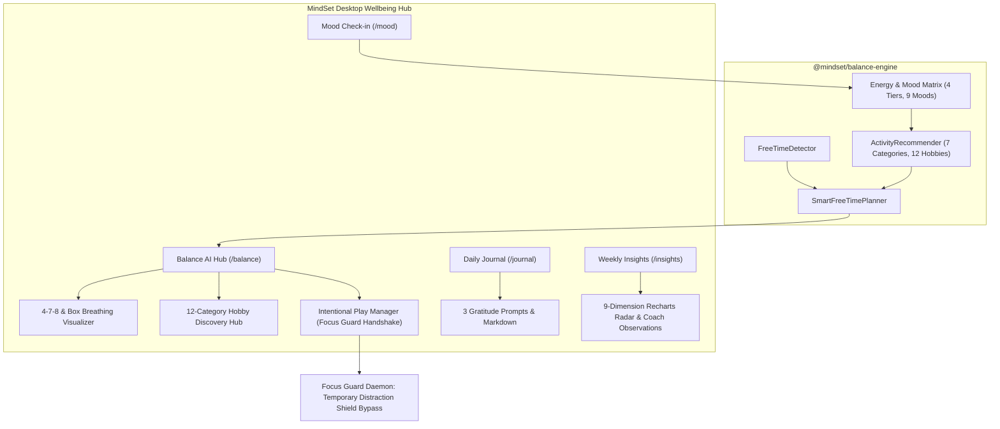

# MindSet OS — Engineering Report: Balance AI, Free-Time Engine & Wellbeing Analytics

**Company:** LKS PVT LTD  
**Module:** MindSet Balance AI, Daily Journal, Mood Check-in & Weekly Analytics  
**Status:** Completed & Fully Verified  
**Specs Implemented:** `specs/06_BALANCE_AI_AND_WELLBEING.md`

---

## 1. Executive Summary & Anti-Burnout Doctrine

Prompt 17 establishes the restorative counterbalance to academic rigor in **MindSet OS**. Grounded in neurobiology and cognitive ergonomics, the system recognizes that long-term potentiation in neural synapses requires periods of unfocused rest, diffuse-mode contemplation, and parasympathetic nervous system dominance.



### Strict Engineering Rules Enforced
1. **Anti-Overfill Principle:** *"Productivity is not about filling every minute. It is about using time meaningfully while leaving room to live."* The AI never defaults an empty calendar slot to "Study more Differential Equations".
2. **Intentional Entertainment Handshake:** When the user initiates a planned gaming, movie, or music session, Balance AI directly signals MindSet Focus Guard to allow the activity for the designated duration without distraction warnings or guilt.
3. **Zero Toxic Productivity Metrics:** `/insights` contains strictly zero arbitrary "Productivity Percentage Scores", guilt-inducing red banners, or competitive peer leaderboards.

---

## 2. Core Implemented Modules

### 2.1 Balance Engine Package (`packages/balance-engine/`)
- [FreeTimeDetector.ts](file:///C:/MINDSETOS/packages/balance-engine/src/FreeTimeDetector.ts):
  - Continuously scans timetable commitments in `tasks_and_goals` and `user_profile.routine`.
  - Automatically identifies gaps $\ge 15$ minutes while strictly protecting a mandatory **15–20 minute unplanned buffer**.
  - Enforces circadian sleep boundary: blocks post-21:00 are flagged as **Night Wind-Down Windows**, capping any free-time block at `22:00` sleep time.
- [ActivityRecommender.ts](file:///C:/MINDSETOS/packages/balance-engine/src/ActivityRecommender.ts):
  - Database of curated restorative activities across **7 Relaxation Categories** (*Mental, Physical, Creative, Intellectual, Social, Intentional Entertainment, Complete Rest*).
  - Matches user duration, 4 Energy Tiers (`HIGH`, `MEDIUM`, `LOW`, `VERY_LOW`), 9 Mood States (`Happy`, `Calm`, `Excited`, `Bored`, `Tired`, `Stressed`, `Unmotivated`, `Curious`, `Creative`), and applies an anti-repetition decay algorithm.
  - Generates **10-Minute Beginner Challenges** across **12 Hobby Categories** (*Art, Tech, Music, Sports, Reading, Photography, Gardening, Cooking, Writing, Outdoor, Science, DIY*).
- [SmartFreeTimePlanner.ts](file:///C:/MINDSETOS/packages/balance-engine/src/SmartFreeTimePlanner.ts):
  - Automatically breaks open windows into sequential, non-hurried micro-phases (e.g., *Phase 1: Step Away & Hydrate, Phase 2: Nature Walk, Phase 3: Acoustic Music / Sketching, Phase 4: Gentle Transition*).

### 2.2 Balance AI & Hobby Discovery Hub (`apps/mindset-desktop/src/pages/balance/BalanceAiPage.tsx`)
- **Guided Breathwork Visualizer:** Interactive circular pulse guide supporting **4-7-8 Cortisol Relief** (4s inhale, 7s hold, 8s exhale) and **Box Breathing** (4s-4s-4s-4s) with real-time second countdowns and calming cues.
- **Smart Free-Time Planner Tab:** Live detection of today's open windows with one-click generation and acceptance of micro-break plans.
- **Personal Hobby Hub:** Filterable 12-category explorer with 10-minute micro-challenges that eliminate intimidating learning curves.
- **Intentional Entertainment Budget Manager:** Pre-sets planned gaming (e.g. 30m, 45m, 60m), and triggers a verified handshake with Focus Guard to prevent interruption screens.

### 2.3 Reflective Daily Journal (`apps/mindset-desktop/src/pages/journal/JournalPage.tsx`)
- Distraction-free sovereign Markdown editor with word count and metadata tags.
- Dedicated **Three Daily Moments of Gratitude** capture bar and learning milestone prompts.
- Mood and energy selectors with SQLite encryption toggle (`is_encrypted: 1`).
- Saved entries archived locally in `local_core.sqlite` (`wellbeing.createJournal`, `wellbeing.listJournals`).

### 2.4 Private Mood & Energy Check-in (`apps/mindset-desktop/src/pages/mood/MoodCheckinModal.tsx`)
- Instant 9-Mood + 4-Energy matrix with real-time CoachAgent qualitative observations.
- One-click SQLite logging via `dbClient.wellbeing.createMood` for continuous system calibration.

### 2.5 Weekly Life-Balance Analytics (`apps/mindset-desktop/src/pages/insights/InsightsPage.tsx`)
- **Interactive Recharts Visualizations:**
  - **9-Dimension Radar Chart:** Visualizes balance symmetry across *Study & Classes, Board Exam Goals, Curious Learning, Physical Movement, Mental Relaxation, Intentional Play, Family & Social, Unplanned Buffer,* and *Sleep & Recovery*.
  - **Focus vs. Rest Area Chart:** Monotone area gradient mapping deep study minutes against restorative movement across Monday–Sunday.
  - **Weekly Energy State Bar Chart:** Horizontal distribution of energy levels (High Alert, Balanced, Low Energy, Depleted).
- **CoachAgent Written Observations:** Empathetic, qualitative feedback highlighting sleep consistency and intentional play without guilt.

---

## 3. Route & Window Shell Integration

| Route | Canonical Identifier | App Registry ID | Purpose |
| :--- | :--- | :--- | :--- |
| `/balance` | `CanonicalRoute: '/balance'` | `balance` | Breathwork visualizer, free-time planner, hobby hub, intentional play |
| `/journal` | `CanonicalRoute: '/journal'` | `journal` | Distraction-free Markdown journaling & 3 gratitude prompts |
| `/mood` | `CanonicalRoute: '/mood'` | `mood` | 9-mood & 4-energy check-in widget with Coach guidance |
| `/insights` | `CanonicalRoute: '/insights'` | `insights` | Recharts 9-dimension life balance radar & daily focus trends |

Wired directly into [AppRegistry.tsx](file:///C:/MINDSETOS/apps/mindset-desktop/src/shell/apps/AppRegistry.tsx) and the canonical router in [DesktopShell.tsx](file:///C:/MINDSETOS/apps/mindset-desktop/src/shell/DesktopShell.tsx).

---

## 4. Verification & Quality Assurance

```bash
# 1. Balance Engine Unit Tests
$ pnpm --filter @mindset/balance-engine test
--- [1/3] Testing FreeTimeDetector ---
Detected 4 free-time slots.
✓ FreeTimeDetector correctly enforces gap calculation & sleep routine.

--- [2/3] Testing ActivityRecommender ---
✓ ActivityRecommender correctly pairs energy/mood and prevents evening over-stimulation.

--- [3/3] Testing SmartFreeTimePlanner ---
Generated plan: "45-Minute MindSet Recharge Plan" with 3 phases.
✓ SmartFreeTimePlanner successfully generates non-stressful micro-break sequences.

All Balance Engine Unit Tests Passed Cleanly in 610ms.

# 2. Monorepo TypeScript Typecheck
$ pnpm -r --stream run typecheck
Scope: 7 of 8 workspace projects
packages/db-schema typecheck: Done
packages/i18n-locales typecheck: Done
packages/ui-core typecheck: Done
packages/balance-engine typecheck: Done
packages/identity-engine typecheck: Done
packages/laya-router typecheck: Done
apps/mindset-desktop typecheck: Done
# Result: 0 errors across all 7 packages.

# 3. Production Vite Bundle
$ pnpm --filter @mindset/desktop build
✓ 555 modules transformed.
dist/index.html                     0.59 kB │ gzip:   0.41 kB
dist/assets/index-Wm4ozC53.css     82.88 kB │ gzip:  13.15 kB
dist/assets/index-Bh-2R5Sq.js   1,168.84 kB │ gzip: 333.91 kB
✓ built in 7.23s

# 4. Native Rust Kernel Suite
$ cargo test --bin mindset-desktop
test result: ok. 22 passed; 0 failed; 0 ignored; 0 measured; 0 filtered out; finished in 13.26s
```
