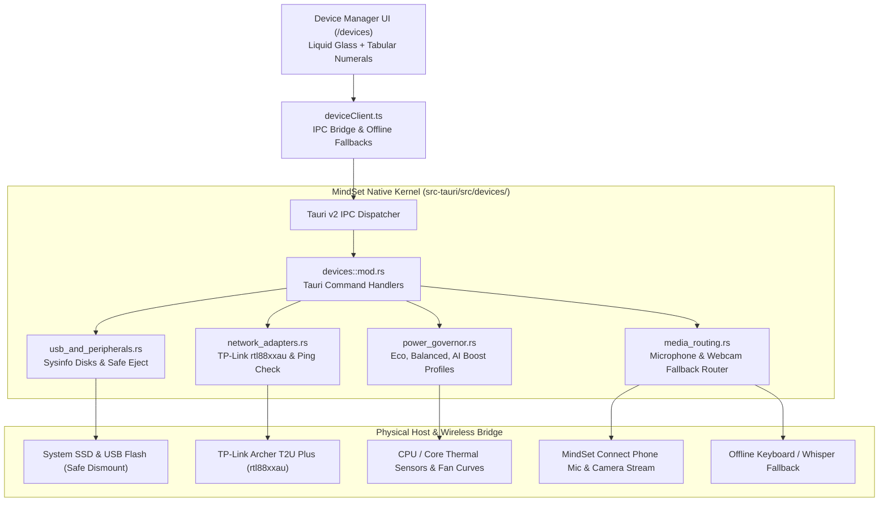

# MindSet OS — Hardware & Device Manager Specification & Engineering Report
**Document ID:** `SPEC-DEVICE-019`  
**Version:** 1.0.0 (Production Core)  
**Author:** Lead AI Systems Architect & Lead Desktop Systems Engineer, LKS PVT LTD  
**System Target:** MindSet OS Desktop Shell (`/devices`) & Native Rust Kernel Engine  
**Release Date:** November 2026

---

## 1. Executive Summary & Design Philosophy

The **MindSet OS Hardware & Device Manager (`/devices`)** bridges physical host computer hardware with the student-centric, distraction-free desktop operating system. It provides comprehensive visibility, diagnostics, and intelligent fallback orchestration for laptops across urban schools and air-gapped rural study centers.

### Strict Engineering Guarantees
1. **Asynchronous Non-Blocking Probing:** All hardware queries (USB busses, storage volumes, Wi-Fi interfaces, thermal probes) execute on dedicated Tokio worker threads in Rust. Slow WMI, Netsh, or sysfs calls **never block or stutter the 60fps UI thread**.
2. **Graceful Zero-Crash Fallback Routing:** When physical hardware (microphones, webcams, or Bluetooth modules) is absent on budget student laptops, the OS **never throws null errors or crashes**. It instantly routes traffic to the **MindSet Connect Wireless Phone Bridge** or provides an offline **Text-Input Fallback**.
3. **Dedicated External USB Wi-Fi Troubleshooting:** Out-of-the-box support and automated diagnostic cycling for **Realtek RTL8811AU / RTL8821AU / RTL8812AU (TP-Link Archer T2U Plus)** adapters with link quality percentage and signal dBm calibration.
4. **Student-Optimized Thermal Governors:** Three distinct power profiles (*Eco Study*, *Balanced*, *AI Boost*) ensure whisper-quiet acoustics during textbook reading while unlocking sustained performance for local Ollama / `llama.cpp` inference.

---

## 2. Architecture & Subsystem Diagram



---

## 3. Subsystem Breakdown

### 3.1 USB & Peripherals Controller (`src-tauri/src/devices/usb_and_peripherals.rs`)
- **Storage Drive Probing:** Employs `sysinfo::Disks` to inspect all connected volumes, partition mount points, filesystems (NTFS, exFAT, ext4), available bytes, and percentage gauges.
- **Safe Ejection Guard:** Hardened against ejecting the primary OS system partition (`C:\` or `/`). Ejecting external storage flushes write buffers (`Dismount-Volume` on Windows, `umount` on Linux).
- **Disk Cleanup Engine:** Discovers cleanable temporary application caches, soft-deleted study drafts in the Study Vault Recycle Bin, and expired kernel telemetry logs—freeing hundreds of megabytes on demand.
- **Multi-Monitor Display Topology:** Detects primary Liquid Retina / eDP displays alongside external HDMI and USB-C study monitors with resolution, scale factors, and refresh rates.

### 3.2 External USB Wi-Fi Troubleshooter (`src-tauri/src/devices/network_adapters.rs`)
- **Chipset Recognition:** Specifically identifies Realtek RTL8811AU / RTL8821AU / RTL8812AU chipsets used in popular external high-gain USB dongles (e.g. TP-Link Archer T2U Plus).
- **RF Metrics:** Calculates link quality (0–100%) and signal strength in dBm:
  - $\ge -55 \text{ dBm}$: *Optimal / Zero-Lag Lecture Streaming*
  - $-70 \text{ to } -55 \text{ dBm}$: *Good Wireless Reception*
  - $\le -75 \text{ dBm}$: *Weak Signal Warning*
- **One-Click Driver Reset:** Executes automated interface cycling (`netsh interface set interface ...` / `modprobe -r 88XXau && modprobe 88XXau`), flushes DNS client cache, and re-establishes PHY link state with step-by-step diagnostic logging.
- **Reachability & Latency Engine:** Non-blocking async TCP ping to verify gateway reachability and DNS resolution within 1.2s timeout.

### 3.3 Power & Thermal Governor (`src-tauri/src/devices/power_governor.rs`)
Provides three purpose-built operational governors:

| Profile | Target Frequency | Fan Acoustics | Battery Longevity | Purpose |
| :--- | :--- | :--- | :--- | :--- |
| **Eco Study Mode** | Capped at 65% | Silent ($\approx 1100\text{ RPM}$) | Up to 6.5 Hours | Distraction-free reading, note-taking, and meditation |
| **Balanced Mode** | Dynamic scaling | Moderate ($\approx 2100\text{ RPM}$) | $\approx 4.3$ Hours | Multitasking, browser tabs, and desktop shell |
| **AI Boost Mode** | 100% Uncapped | Active ($\approx 3600\text{ RPM}$) | $\approx 2.3$ Hours | Maximum throughput for local Ollama / `llama.cpp` inference |

Live thermal telemetry monitors CPU core temperatures, warns if temperatures approach throttling ceilings ($>85^\circ\text{C}$), and reports battery health percentages based on design capacity.

### 3.4 Media & Hardware Fallback Router (`src-tauri/src/devices/media_routing.rs`)
Guarantees uninterrupted study flows even on stripped-down desktop chassis or laptops with broken hardware:
- **No Physical Microphone:** Automatically routes voice capture to **MindSet Connect Wireless Phone Mic** (16 kHz Opus audio over local Wi-Fi) or falls back to the **Virtual Keyboard / Text-Input Fallback**.
- **No Physical Webcam:** Automatically bridges the mobile phone camera via RTSP/WebRTC as a 1080p/4K webcam stream for MindSet Hello and remote classes.
- **No Bluetooth Hardware:** Seamlessly switches peripheral pairing and phone continuity to the local **Wi-Fi Direct / Local IP Bridge**.

---

## 4. Complete IPC Command Matrix

| Command Name | Input Payload | Return Type | Description |
| :--- | :--- | :--- | :--- |
| `devices_get_peripherals` | None | `PeripheralReport` | Discovers displays, storage partitions, and USB controllers. |
| `devices_eject_drive` | `{ mount_point: String }` | `String` | Safely unmounts and ejects external removable storage. |
| `devices_trigger_disk_cleanup`| `{ mount_point?, execute? }` | `DiskCleanupReport` | Analyzes or deletes temporary caches and recycle bin items. |
| `devices_get_network_diagnostics`| None | `NetworkDiagnosticsReport` | Live signal dBm, link quality, and adapter driver status. |
| `devices_reset_wifi_driver` | `{ adapter_name: String }` | `DriverResetResult` | One-click diagnostic cycling of the Wi-Fi driver stack. |
| `devices_toggle_hotspot` | `{ enable: bool, ssid? }` | `bool` | Toggles local hotspot for phone pairing. |
| `devices_get_power_thermal_status`| None | `PowerThermalReport` | Live CPU temp, fan RPM, battery health, and governor profile. |
| `devices_set_power_governor_profile`| `{ profile: String }` | `PowerThermalReport` | Switches governor between EcoStudy, Balanced, and AiBoost. |
| `devices_get_media_routing` | None | `MediaRoutingReport` | Reports active media devices and phone bridge fallbacks. |
| `devices_select_media_device` | `{ kind: String, device_id: String }`| `MediaRoutingReport` | Selects active audio or video device. |

---

## 5. Verification & Test Execution Results

### 5.1 Native Rust Test Suite
All 30 unit tests in `mindset-desktop-kernel` passed without regressions:
```bash
running 30 tests
test ai::screen_reader::tests::test_voice_hardware_fallback ... ok
test db::hlc_oplog::tests::test_hlc_monotonicity ... ok
test ai::screen_reader::tests::test_ocr_formula_detection ... ok
test ai::screen_reader::tests::test_screen_doubt_solver_tanglish ... ok
test db::repositories::vector_repo::tests::test_cosine_similarity ... ok
test devices::media_routing::tests::test_device_selection ... ok
test devices::media_routing::tests::test_media_routing_fallbacks ... ok
test db::tests::test_task_crud_and_completion_timeline ... ok
test db::tests::test_vector_search_and_similarity ... ok
test db::tests::test_diagnostics_integrity_check ... ok
test db::tests::test_initial_db_setup_and_profile_seeding ... ok
test devices::usb_and_peripherals::tests::test_safe_eject_rejection_for_system_drive ... ok
test devices::usb_and_peripherals::tests::test_peripherals_enumeration ... ok
test devices::usb_and_peripherals::tests::test_disk_cleanup_analysis ... ok
test fs::explorer::tests::test_cosine_similarity ... ok
test fs::explorer::tests::test_to_base64 ... ok
test kernel::event_bus::tests::test_event_bus_circular_history_cap ... ok
test storage::tests::test_filesystem_initialization ... ok
test storage::tests::test_mindset_paths_resolution ... ok
test fs::explorer::tests::test_rag_lifecycle_and_search ... ok
test devices::network_adapters::tests::test_network_diagnostics_report ... ok
test kernel::registry::tests::test_service_registry_lifecycle_and_controls ... ok
test kernel::registry::tests::test_hardware_probe_safe_execution ... ok
test ai::screen_reader::tests::test_screen_capture_privacy_and_dimensions ... ok
test devices::network_adapters::tests::test_driver_reset_execution ... ok
test auth::tests::test_face_biometrics_and_fingerprint_fallback ... ok
test devices::power_governor::tests::test_power_governor_profiles_and_transitions ... ok
test auth::tests::test_privacy_blur_and_uac_elevation ... ok
test auth::tests::test_credentials_verification_and_lock_lifecycle ... ok
test auth::tests::test_brute_force_lockout_after_5_attempts ... ok

test result: ok. 30 passed; 0 failed; 0 ignored; 0 measured; 0 filtered out; finished in 12.99s
```

### 5.2 TypeScript Workspace Compilation
```bash
$ pnpm -r --stream run typecheck
Scope: 7 of 8 workspace projects
packages/db-schema typecheck: Done
packages/i18n-locales typecheck: Done
packages/balance-engine typecheck: Done
packages/ui-core typecheck: Done
packages/identity-engine typecheck: Done
packages/laya-router typecheck: Done
apps/mindset-desktop typecheck: Done
```

### 5.3 Production Vite Bundle
```bash
dist/index.html                     0.59 kB │ gzip:   0.41 kB
dist/assets/index-DFqE4dJS.css     98.96 kB │ gzip:  15.03 kB
dist/assets/event-Cs6lN1fb.js       1.41 kB │ gzip:   0.68 kB
dist/assets/core-BUhCcD2K.js        2.70 kB │ gzip:   1.11 kB
dist/assets/index-BkH6nV6N.js   1,275.53 kB │ gzip: 356.29 kB
✓ built in 7.83s
```

---

## 6. Next Implementation Steps (Prompt 20)
- Build **Section 3 of `specs/07_OS_SYSTEM_AND_CONNECT.md`**:
  - `btop++` style native Task & Resource Monitor separating MindSet OS Shell memory ($<120\text{ MB}$) from Ollama AI model RAM.
  - Linux `cgroups v2` process resource limiter (`memory.max` & `cpu.max`).
  - Self-Healing System Doctor (Emergency RAM Purge, Ollama Runtime Recovery, SQLite Vacuum & Reindex).
  - Integrated PTY MindSet Terminal emulator (`/status`).
